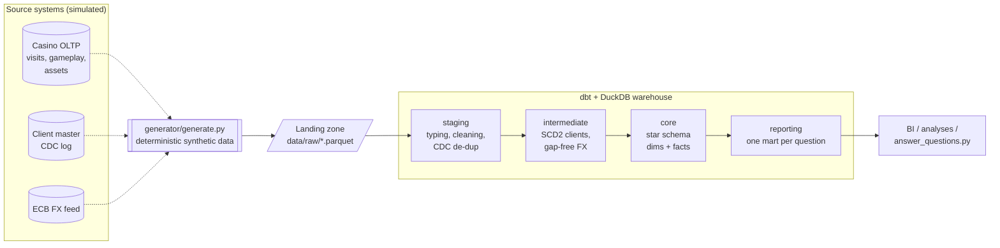
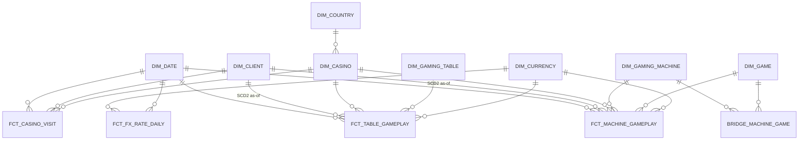

# 🎰 Casino Data Warehouse: dimensional model & ELT pipeline


An end-to-end data warehouse for a casino operator with venues in **Estonia, Latvia, Lithuania and Croatia**.
It started as a DWH design assignment (build an ERD and make sure it can answer 9 business questions). The project goes further and implements the design as a tested, incremental **dbt + DuckDB** pipeline that runs on synthetic data.

> **TL;DR**: `make all` generates about 1.1M gameplay rows, builds a Kimball star schema with SCD2 clients and multi-currency FX, runs **147 dbt nodes (100+ data-quality tests)** and prints the answers to all 9 questions. It finishes in about 15 seconds on a laptop, with no cloud account needed.

---

## Contents
- [The assignment](#the-assignment)
- [Architecture](#architecture)
- [Data model](#data-model)
- [Design decisions](#design-decisions)
- [Data quality](#data-quality)
- [Quick start](#quick-start)
- [Answers to the business questions](#answers-to-the-business-questions)
- [Project layout](#project-layout)
- [Production roadmap](#production-roadmap)

## The assignment

Design a DWH data model (ERD) for these entities: *Casino, Gaming Machine, Gaming Machine Game, Gaming Table, Gaming Table Type, Client, Casino Visit, Client Gaming Machine Game, Client Gaming Table Game*. Add the dimensions you need and show that the model can answer these questions:

| # | Question |
|---|---|
| 1 | How many unique customers did we have in total per country at any given date? |
| 2 | How many new customer registrations did we have during the last 7 days? |
| 3 | How many unique customer visits were made per day per casino? |
| 4 | What was the customer's total bet amount in EUR per day per casino? |
| 5 | What was the customer's total win amount in EUR per day per casino? |
| 6 | Which gaming machine had the most played games per day? |
| 7 | Which gaming machine made the most profit per day? |
| 8 | Which gaming table had the most played games per day? |
| 9 | Which gaming table made the most profit per day? |

All monetary transactions happen in the **local currency** of the country.

## Architecture



| Layer | Schema | Materialization | Purpose |
|---|---|---|---|
| Landing | Parquet files | n/a | Immutable extracts, the same shape an ingestion tool would land |
| Staging | `staging` | view | 1:1 with sources: rename, cast, normalise, de-duplicate CDC events |
| Intermediate | `intermediate` | table | Business logic that is reused: SCD2 client history and the daily FX rate series |
| Core | `core` | table / **incremental** | Kimball star schema: conformed dimensions and atomic-grain facts |
| Reporting | `reporting` | table | Marts shaped for the questions |

## Data model

The full ERDs (logical source model and star schema), the list of minimum attributes and the reasons for every added entity are in **[docs/erd.md](docs/erd.md)**.



**Added beyond the assignment:** `dim_date`, `dim_country`, `dim_currency`, `fct_fx_rate_daily` (with source `country_currencies` and the `fixed_conversion_rates` seed), SCD2 history on `dim_client`, and a **time-bounded** `bridge_machine_game`.

## Design decisions

<details open>
<summary><b>1. Currency is stored on the transaction, not derived from the country</b></summary>

Croatia replaced the **kuna (HRK) with the euro on 1 Jan 2023**. The synthetic data covers Oct 2022 to Mar 2023 on purpose so that the switch is included. If currency were looked up from the casino's country, every December 2022 HRK bet would be summed as euros and overstated about 7.5 times. So:

* every gameplay row carries `currency_code`
* `country_currencies` records which currency was legal tender, with validity dates, and a test (`assert_currency_is_legal_tender`) checks it
* facts store **both** local and EUR amounts, plus the rate that was applied, which keeps them auditable

</details>

<details>
<summary><b>2. Gap-free daily FX series</b></summary>

The ECB publishes reference rates on TARGET business days only, and stopped quoting HRK after 30 Dec 2022. `int_fx_rates__daily` builds one rate per currency per calendar day:

| `rate_type` | Rule |
|---|---|
| `IDENTITY` | EUR → 1 |
| `ECB_PUBLISHED` | rate published that day |
| `ECB_FORWARD_FILLED` | weekend or holiday: last published rate (DuckDB `ASOF JOIN`) |
| `FIXED_CONVERSION` | legacy currency after euro adoption: irrevocable rate from the `fixed_conversion_rates` seed (HRK 7.53450) |

</details>

<details>
<summary><b>3. Clients: natural key + SCD Type 2 from CDC</b></summary>

* `client_id` is the source key. The **physical person** is identified by `document_type + document_number + document_country_code` (`person_key`). Everyone entering the casino is ID-checked, so this is always present, and document numbers are only unique within the issuing country.
* The client master arrives as a **CDC log** (inserts and updates, with occasional duplicate deliveries). Staging de-duplicates it. `int_clients__scd2` collapses no-op events (using an attribute hash) and builds `valid_from / valid_to` intervals.
* Facts join the client version that was **valid at the moment of the event**. Q1 ("customers per country *at any given date*") uses a date spine × SCD2 point-in-time join, so a client who moved from Latvia to Estonia is counted in the right country on each date.
* A custom generic test `scd2_valid_intervals` checks that intervals have no overlaps or gaps and that each client has exactly one current row.

</details>

<details>
<summary><b>4. Gaming day instead of calendar day</b></summary>

Casinos operate past midnight. A spin at 02:00 on Saturday belongs to Friday's shift and accounting. All "per day" metrics use a **gaming day** with a configurable cut-off (`var('gaming_day_cutoff_hour')`, default 06:00). FX conversion still uses the transaction's calendar date. The two can differ: on the night of the euro changeover, games played between 00:00 and 06:00 on 1 Jan 2023 were in EUR but belong to the 31 Dec gaming day.

</details>

<details>
<summary><b>5. Profit = GGR on settled rounds</b></summary>

Profit (from the casino's point of view) is **Gross Gaming Revenue** = bets − wins. Rounds with status `ongoing` (machines) or `undefined` (tables, e.g. voided hands) count towards *games played*, but they don't contribute to GGR because their outcome isn't final.

</details>

<details>
<summary><b>6. Machine ↔ game is many-to-many and changes over time</b></summary>

"One machine can have several games, and one game can be installed on several machines." `bridge_machine_game` carries `installed_from / installed_to`. The test `assert_machine_game_was_installed` checks that no gameplay refers to a game that wasn't installed on that machine on that date.

</details>

<details>
<summary><b>7. Incremental, idempotent fact loads</b></summary>

`fct_machine_gameplay` and `fct_table_gameplay` are `incremental` with `delete+insert` on `gameplay_id`. Each run reprocesses a look-back window (`var('incremental_lookback_days')`) to pick up late-arriving rows and status changes (`ongoing` → `win`/`loss`). CI runs the build twice to show that re-runs are idempotent.

</details>

<details>
<summary><b>8. Ties and an explicit "as of" date</b></summary>

* Q6–Q9 use `rank()`, not `row_number()`. When two machines tie, both are reported (`tied_assets`, `top_assets`), so the result doesn't depend on an arbitrary sort order.
* Q2's "last 7 days" is relative to `var('report_date')`, which defaults to the latest activity date in the warehouse. Reports are reproducible: `dbt build --vars '{report_date: 2023-02-14}'`.

</details>

<details>
<summary><b>9. Star schema, with the table type denormalised</b></summary>

`Gaming Table Type` is folded into `dim_gaming_table` (`table_type_code`, `table_type_name`). This is the usual Kimball choice for a small, low-cardinality attribute: one join fewer for every table-level report. Surrogate keys are deterministic hashes, so dimensions and facts can be built in parallel and rebuilt without remapping keys.

</details>

## Data quality

**147 dbt nodes** are built and tested on every push (GitHub Actions):

| Kind | Examples |
|---|---|
| Schema tests | `unique`, `not_null`, `relationships` for every FK in the star, `accepted_values` for statuses and CDC ops |
| Custom generic tests | `scd2_valid_intervals`, `unique_combination` (composite grain), `non_negative` |
| Business-rule tests | win > 0 ⇔ status = win · gameplay happens inside the client's visit window · game was installed on the machine at play time · currency was legal tender in that country on that date · visit happens after registration |
| Reconciliation | row counts and EUR totals match from **source → fact → report** |

Several of these tests caught real bugs in the synthetic generator while the project was being built, for example visits that started after the extract cut-off.

## Quick start

```bash
git clone https://github.com/Dobriy15/Casino-dwh.git && cd casino-dwh
python -m venv .venv && source .venv/bin/activate
make install
make all          # generate data → dbt build (+tests) → print answers
make docs         # dbt docs with lineage graph at http://localhost:8080
```

Other targets: `make data SCALE=0.1` (quick small dataset), `make incremental`, `make test`, `make clean`.

Or with Docker:

```bash
docker build -t casino-dwh . && docker run --rm casino-dwh
```

To query the warehouse directly:

```bash
duckdb warehouse/casino_dwh.duckdb "select * from reporting.rpt_top_assets_daily order by game_date desc limit 8"
```

## Answers to the business questions

Each question has an analysis in [`dbt/analyses/`](dbt/analyses) that reads from a reporting mart. `make answers` runs them all and writes **[docs/sample_answers.md](docs/sample_answers.md)**.

| # | Mart | Notes |
|---|---|---|
| 1 | `rpt_clients_by_country_daily` | Two readings: by **residence country** (SCD2, point-in-time) and by **country of casinos visited** |
| 2 | `rpt_new_registrations_last_7_days` | Per registering casino plus a total row |
| 3 | `rpt_casino_daily_visits` | Unique visitors, total entries, first-time visitors, average stay |
| 4–5 | `rpt_client_casino_daily_gaming` | Total bet and win in EUR, split by machines and tables |
| 6–9 | `rpt_top_assets_daily` (+ `rpt_gaming_machine_daily`, `rpt_gaming_table_daily`) | Daily ranks, ties preserved |

## Project layout

```
casino-dwh/
├── generator/generate.py        # deterministic synthetic source data (Parquet)
├── dbt/
│   ├── models/
│   │   ├── staging/             # stg_raw__*        (views)
│   │   ├── intermediate/        # int_clients__scd2, int_fx_rates__daily
│   │   └── marts/
│   │       ├── core/            # dim_*, fct_*, bridge_machine_game
│   │       └── reporting/       # rpt_* - one per business question
│   ├── macros/                  # surrogate_key, gaming_date, gameplay_fact, generic tests
│   ├── seeds/                   # fixed_conversion_rates.csv
│   ├── tests/                   # singular business-rule & reconciliation tests
│   └── analyses/                # q1..q9 - the answers
├── scripts/answer_questions.py
├── docs/erd.md                  # logical ERD + star schema + design rationale
├── .github/workflows/ci.yml     # generate → build → re-build incrementally → answer → docs
├── Makefile · Dockerfile · requirements.txt
```

## Production roadmap

What would change for a real deployment:

- **Warehouse:** swap the `duckdb` profile for Snowflake, BigQuery or Postgres. Models use standard SQL plus a few portable functions. `ASOF JOIN` and `QUALIFY` would need adapter-specific macros on Postgres.
- **Ingestion:** Debezium/Kafka or Fivetran for OLTP CDC, plus a small ECB API job for FX, landing in S3/GCS (`RAW_DATA_PATH` already points at an object-store path).
- **Orchestration:** Airflow or Dagster (`dagster-dbt`), with source freshness checks and an SLA on the FX feed.
- **Time zones:** timestamps are local casino time today. Storing UTC plus `dim_casino.timezone` would make cross-country intraday analysis exact.
- **Privacy (GDPR):** split PII (name, document, email) into a restricted `dim_client_pii`, and keep only `person_key` in the main dimension.
- **Semantic layer:** define GGR, hold %, and unique visitors once (dbt Semantic Layer / MetricFlow).

---

*All data is synthetic, generated by `generator/generate.py`. Casino names are fictional.*
