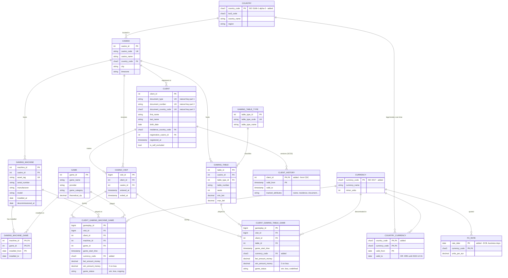
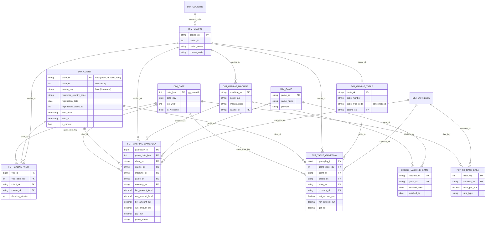

# Data model

Two levels of the model are documented here:

1. **Logical / source ERD**: the entities from the assignment plus the additional entities needed to answer the reporting questions correctly.
2. **Dimensional model (star schema)**: how the warehouse stores those entities for reporting.

---

## 1. Logical ERD (source entities)

Entities and attributes commented **added** are **not in the assignment**. They were added because the reporting questions can't be answered correctly without them (see [Why the extra entities](#why-the-extra-entities)).

### Minimum attributes, with reasons

| Need | Attribute(s) | Why |
|---|---|---|
| Identify a customer uniquely | `document_type + document_number + document_country_code` | `client_id` is only the source-system key. A physical person is identified by their ID document, and document numbers are only unique within the issuing country. Every client is ID-checked at the door, so this data always exists. |
| Report money in EUR | `currency_code` on every gameplay + `FX_RATE` + `COUNTRY_CURRENCY` | Transactions are in local currency. Croatia used **HRK until 2022-12-31** and EUR afterwards, so the currency can't be derived from the country alone. It has to be stored on the transaction. |
| "per country at any given date" | `residence_country_code` with history (`CLIENT_HISTORY`) | Clients move. A point-in-time answer needs to know where the client lived *on that date*, which means SCD type 2. |
| "new registrations" | `registered_at`, `registration_casino_id` | A registration is separate from the first visit. |
| "visits per day" | `entered_at`, `exited_at` | Visits are counted per gaming day. |
| "profit" | `bet_amount_money`, `win_amount_money`, `game_status` | Profit (GGR) = bets − wins, counted on **settled** rounds only (`ongoing` / `undefined` rounds are excluded). |
| A game installed on several machines | `GAMING_MACHINE_GAME` with validity dates | A many-to-many relationship, and the installed games change over time. |

### Why the extra entities

* **Country**: casinos operate in 4 countries, and Q1 groups by country. A reference table gives ISO codes, names and a region attribute that can be extended.
* **Currency + Country_Currency**: needed for correct EUR reporting. *Croatia adopted the euro on 1 Jan 2023*. Without a time-bounded currency mapping, December 2022 HRK amounts would be summed as if they were euros, overstating them about 7.5 times.
* **FX_Rate**: daily ECB reference rates. The ECB doesn't publish on weekends or holidays, and stopped quoting HRK after 30 Dec 2022, so the warehouse forward-fills gaps and uses the irrevocable rate **7.53450** after the changeover.
* **Client_History (SCD2)**: answers "*at any given date*" correctly when a client's residence country changes.
* **Date (in the warehouse)**: a conformed calendar. Gaming day, ISO week and weekend flags are used by every "per day" question.

---

## 2. Dimensional model (star schema)

### Question → model coverage

| # | Question | Answered by | Key mechanics |
|---|---|---|---|
| 1 | Unique customers per country at any date | `rpt_clients_by_country_daily` | Date spine × SCD2 point-in-time join. Two readings are given: by residence country, and by the country of the casinos visited |
| 2 | New registrations in the last 7 days | `rpt_new_registrations_last_7_days` | `report_date` variable (defaults to the latest activity date), split per casino plus a total |
| 3 | Unique visits per day per casino | `rpt_casino_daily_visits` | `count(distinct client_id)` per gaming day |
| 4 | Customer total bet (EUR) per day per casino | `rpt_client_casino_daily_gaming.total_bet_eur` | FX conversion in the facts |
| 5 | Customer total win (EUR) per day per casino | `rpt_client_casino_daily_gaming.total_win_eur` | as above |
| 6 | Machine with most games per day | `rpt_top_assets_daily` (machine / most_games_played) | `rank()`; ties are kept |
| 7 | Machine with most profit per day | `rpt_top_assets_daily` (machine / most_profit_eur) | GGR on settled rounds |
| 8 | Table with most games per day | `rpt_top_assets_daily` (table / most_games_played) | |
| 9 | Table with most profit per day | `rpt_top_assets_daily` (table / most_profit_eur) | |
